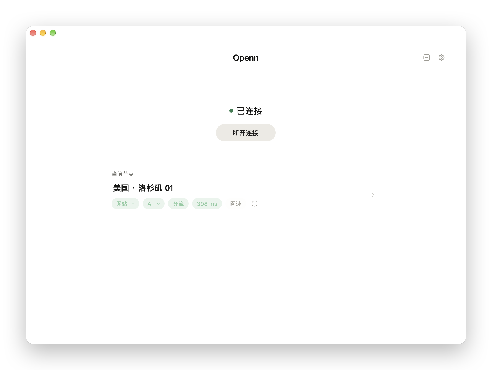
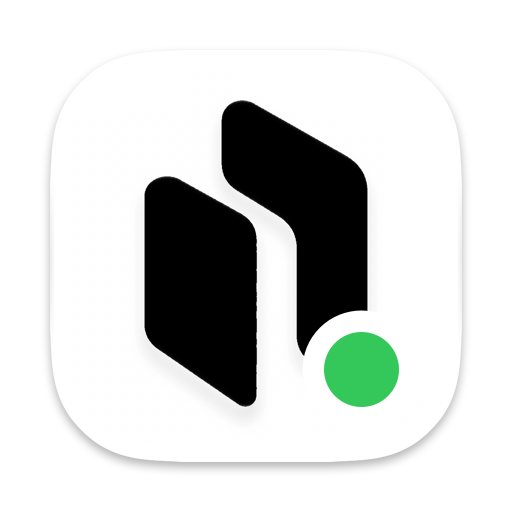
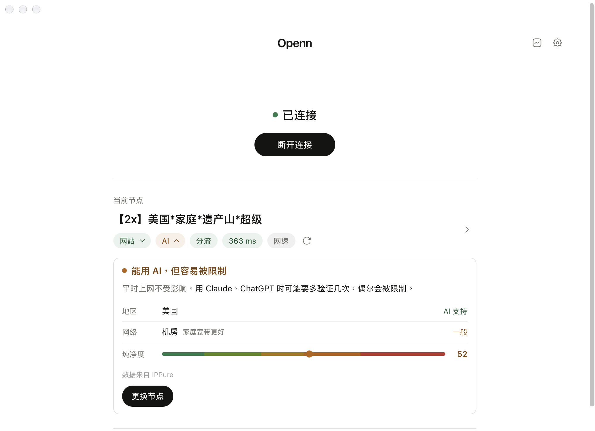
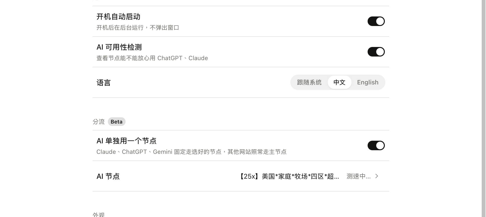
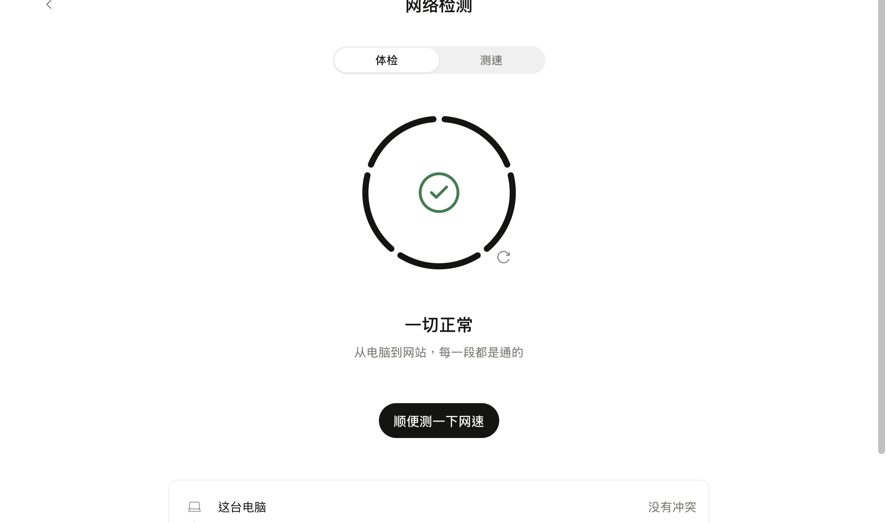

  

<h1 align="center">Openn</h1>

<strong>一款简单好看的 Mac 代理软件，谁都能轻松上手。</strong>

基于 <a href="https://github.com/clash-verge-rev/clash-verge-rev">Clash Verge Rev</a> 改造 · 适用于 Apple 芯片的 Mac（macOS 11 及以上）

  
   
  

  <a href="https://github.com/maxiida/openn/releases">版本发布</a> ·
  <a href="./Changelog.md">更新记录</a> ·
  <a href="https://github.com/maxiida/openn/issues">问题反馈</a> ·
  <a href="./docs/README_en.md">English</a>

  

我到现在用 Clash Verge，还是有不少设置看不懂。其实我平时只是想打开软件，点一下连接，然后继续做自己的事。Openn 就是按这个想法做的代理软件。

## 开始使用

点上面的「下载 Openn」按钮，或者到 [GitHub Releases](https://github.com/maxiida/openn/releases/latest) 下载 `Openn_aarch64.dmg`。打开后把 Openn 拖进「应用程序」文件夹。

第一次打开 Openn，粘贴代理服务商给你的订阅链接，按提示完成一次授权。Openn 会测试线路，帮你选一个响应快的节点。之后，连接和断开都用首页的同一个按钮。关掉窗口，Openn 也会继续在后台运行。

> [!NOTE]
> Openn 暂时没有经过 Apple 公证，第一次打开时 macOS 会提示无法验证开发者。先点「完成」，再打开「系统设置 → 隐私与安全性」，在页面下方点 Openn 旁边的「仍要打开」。之后就能正常打开了。

## 看一眼，就知道连得怎么样

Openn 会在后台检查当前线路，菜单栏和 Dock 图标上的小点会随连接状态变化。

| 连接正常 | 检测到连接问题 | 未连接 |
| :---: | :---: | :---: |
|  |  |  |

## 用 Claude 或 ChatGPT 前，先看看线路合不合适

有的线路平时浏览网页没问题，用 Claude 或 ChatGPT 时却可能遇到地区限制或额外验证。Openn 会检查节点出口 IP 的地区和风险评分，帮你判断这条线路是否适合使用这些服务。你也可以在节点列表里一次检查多条线路，再决定换哪一条。

  

选好合适的线路后，还可以在设置里让 Claude、ChatGPT 和 Gemini 固定走这条线路，其他网站照常走主节点。这样换主节点时，AI 账号的 IP 也不会跟着变。

  

## 网慢、网页打不开，自己也能查

是家里的网断了、订阅过期了，还是节点没响应？打开「网络检测」，Openn 会从电脑一路查到网站，并提示你接下来可以怎么做。

  

如果只是觉得慢，也可以分别测宽带本身的速度和经过代理后的速度，看看差在哪儿。

## 和 Clash Verge Rev 有什么不同

| | Openn | Clash Verge Rev |
| :-- | :-- | :-- |
| 适合谁 | 只想打开、连接、继续做事的人 | 想自己调规则和配置的人 |
| 平台 | 仅 Apple 芯片的 Mac | Windows、macOS、Linux |
| 首次使用 | 粘贴订阅链接，自动选节点 | 自己导入订阅、选节点 |
| 判断线路能不能用 AI | 内置，显示地区和纯净度评分 | 没有 |
| AI 固定走一条线路 | 设置里一个开关 | 自己写规则 |
| 排查网络问题 | 内置「网络检测」，从电脑查到网站 | 没有 |
| 规则、脚本、配置文件编辑 | 没有 | 有 |

## 关于这个项目

Openn 基于 [Clash Verge Rev](https://github.com/clash-verge-rev/clash-verge-rev) 开发，沿用 Mihomo 内核处理代理连接。我在这个基础上重新设计了 Mac 界面和首次使用流程，让连接、看状态和排查网络问题都更容易上手。感谢上游项目维护者。

你的订阅和设置保存在自己的 Mac 上。连接检测、测速和 AI 检测会访问对应的第三方服务，详情见[隐私说明](./PRIVACY.md)。项目采用 [GPL-3.0 许可证](./LICENSE)。

## 从源码运行

本地构建需要主仓库和后台组件的源码。安装依赖、运行和发版步骤见[开发文档](./docs/DEVELOPMENT.md)。
