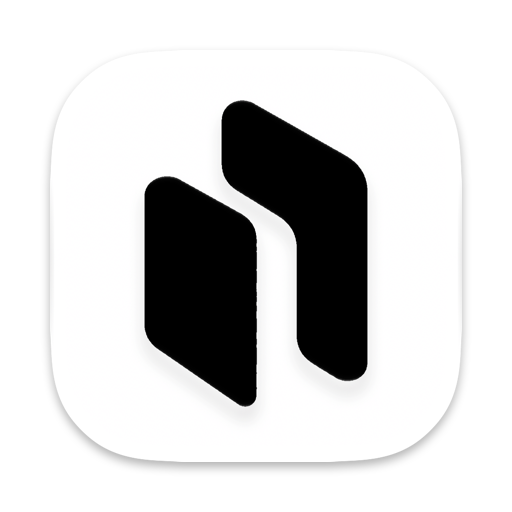
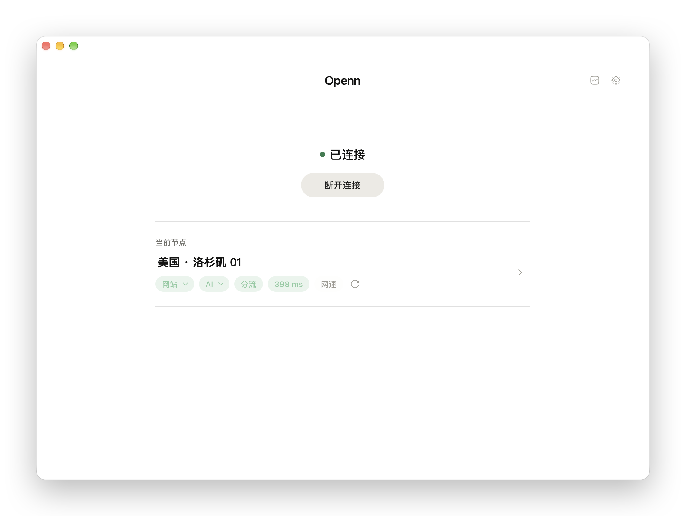
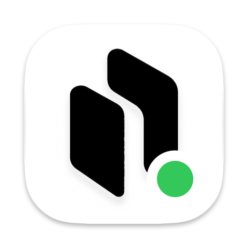
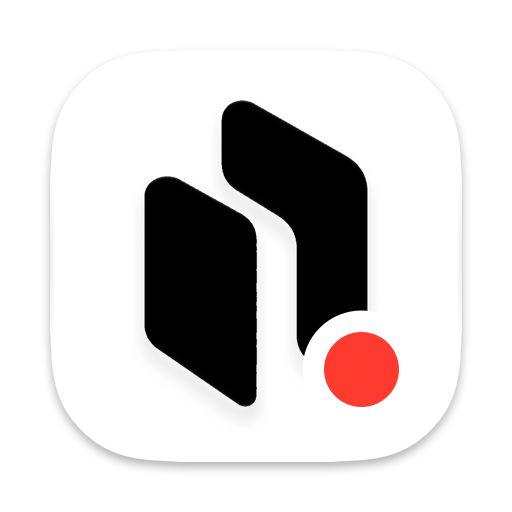

  

<h1 align="center">Openn</h1>

<strong>A simple, beautifully designed proxy app for Mac that anyone can use.</strong>

Built on <a href="https://github.com/clash-verge-rev/clash-verge-rev">Clash Verge Rev</a> · For Macs with Apple silicon (macOS 11 or later)

  
   
  

  <a href="https://github.com/maxiida/openn/releases">Releases</a> ·
  <a href="../Changelog.md">Changelog</a> ·
  <a href="https://github.com/maxiida/openn/issues">Report an issue</a> ·
  <a href="../README.md">简体中文</a>

  

I still find a lot of the settings in Clash Verge hard to understand. Most days, I just want to open an app, click Connect, and get on with what I was doing. That’s why I built Openn.

## Getting started

Click **Download Openn** above, or get `Openn_aarch64.dmg` from [GitHub Releases](https://github.com/maxiida/openn/releases/latest). Open it and drag Openn to your Applications folder.

On your first launch, paste the subscription link from your proxy provider and follow the prompts to grant permission. Openn tests your connections and helps you pick one that responds quickly. After that, use the same button to connect or disconnect. You can close the window and leave Openn running in the background.

> [!NOTE]
> Openn isn’t notarized by Apple yet, so the first time you open it, macOS says it can’t verify the developer. Click **Done**, then go to **System Settings → Privacy & Security** and click **Open Anyway** next to Openn. After that, it opens normally.

## Check your connection at a glance

Openn checks your connection in the background. Its menu bar and Dock icons show how it’s doing.

| Working | Connection problem detected | Disconnected |
| :---: | :---: | :---: |
|  |  |  |

## Find a connection for Claude or ChatGPT

A connection can work for everyday browsing and still run into region restrictions or extra verification on Claude or ChatGPT. Openn checks the region and risk score of the IP address your traffic goes out through. You can also check several connections at once before deciding which one to use.

Once you’ve found a good one, you can have Claude, ChatGPT, and Gemini always use it while everything else uses your main connection. Switching your main connection then won’t change the IP address your AI accounts see.

## Find out why a page won’t load

Is your internet down, has your subscription expired, or has your proxy stopped responding? Open **Network Check** and Openn will test each step from your Mac to the website and suggest what to try next.

If things just feel slow, you can test your internet speed both with and without the proxy to see where the slowdown is.

## About the project

Openn is based on [Clash Verge Rev](https://github.com/clash-verge-rev/clash-verge-rev) and uses Mihomo to handle proxy connections. I redesigned the Mac interface and first-run setup to make connecting, checking your status, and troubleshooting easier. Thanks to the upstream maintainers for making Openn possible.

Your subscription and settings are stored on your Mac. Connection checks, speed tests, and AI checks contact third-party services as described in the [privacy notice](../PRIVACY.md). Openn is licensed under [GPL-3.0](../LICENSE).

## Run from source

The local build needs both the main repository and the background service. See the [development guide](./DEVELOPMENT.md) for setup, build, and release instructions.
